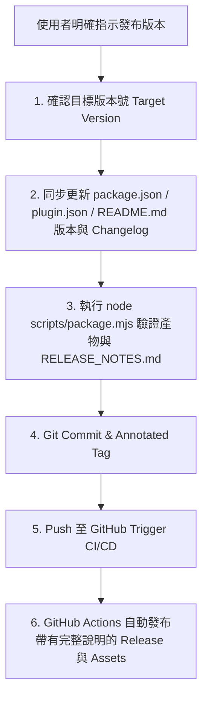

# AGY Git Graph - Release Skill 🚀

本技能專用於 **AGY Git Graph 的版本發布與 GitHub Release 流程**。

> ⚠️ **執行防線**：
> **本技能僅在使用者明確要求發布至 Git / GitHub（例如：「發布新版本」、「Release vX.Y.Z」）時才能啟動執行。**
> 平時本機修改、除錯、測試打包時絕對不可觸發此流程（請改用 `local-package` skill）！

---

## 發布工作流程 (Release Workflow)



---

## 詳細執行步驟

### 步驟 1：確認目標版本號 (Semantic Versioning)
- 確認本次發布版本號（例如：`1.0.6`、`1.1.0`）。若使用者未指定，預設由目前 `package.json` 的版本進行 patch 遞增。

### 步驟 2：同步更新設定檔、README 與 Release 資訊 (Synchronous Bump & Release Notes)
在 Commit 或打 Tag 前，**必須同時且一致地更新下列三個檔案**：
1. **`package.json`**：更新 `"version": "X.Y.Z"`
2. **`plugin.json`**：更新 `"version": "X.Y.Z"`
3. **`README.md`**：
   - 更新頂部版本徽章：`Version-vX.Y.Z`
   - 在 `## 📋 版本更新紀錄 / Changelog` 最上方新增 `### vX.Y.Z (YYYY-MM-DD)` 區塊，清楚條列本次發布的新增功能、修復項目或改進內容（`scripts/package.mjs` 會自動讀取此區塊產生 GitHub Release 頁面說明 `dist/RELEASE_NOTES.md`）。

### 步驟 3：執行打包程式驗證 (Build, Package & Generate Release Notes)
在專案根目錄執行發布打包腳本進行本地產物與 Release 說明驗證：
```bash
node scripts/package.mjs
```
確認 `dist/` 生成以下檔案：
- `dist/agy-git-graph-v<VERSION>-setup.exe` (Windows 原生雙擊安裝檔)
- `dist/agy-git-graph-v<VERSION>-uninstall.exe` (Windows 雙擊解除安裝檔)
- `dist/agy-git-graph-v<VERSION>-setup.sh` (Linux / macOS 自動安裝檔)
- `dist/agy-git-graph-v<VERSION>-uninstall.sh` (Linux / macOS 自動解除安裝檔)
- `dist/agy-git-graph-v<VERSION>.zip` (通用 ZIP 壓縮包)
- `dist/agy-git-graph-v<VERSION>.tar.gz` (Linux / macOS 壓縮包)
- `dist/SHA256SUMS.txt` (校驗碼清單)
- `dist/RELEASE_NOTES.md` (自動生成的 GitHub Release 完整說明檔，內含本次更新內容、安裝說明與 SHA-256 校驗碼)

> 注意：`dist/` 已被 `.gitignore` 忽略，嚴禁將 `dist/` 產物提交進 Git 倉庫。

### 步驟 4：Git 提交與建立標籤 (Commit & Tag)
確認 `README.md` 與版本資訊皆已更新後，嚴格以 `Corvus+` 身分進行提交與建立標籤：
```bash
git add package.json plugin.json README.md
git commit -m "chore(release): v<VERSION> - <簡短更新摘要>"
git tag -a "v<VERSION>" -m "Release v<VERSION>"
```

### 步驟 5：推送至 GitHub 觸發自動發布 (Push to Trigger Release)
推送 Commit 與 Tag 至遠端 GitHub 儲存庫：
```bash
git push origin main --tags
```
專案內建的 GitHub Actions 工作流程（`.github/workflows/release.yml`）偵測到 `v*` 標籤後，會在雲端執行 `node scripts/package.mjs` 並讀取 `dist/RELEASE_NOTES.md` 自動建立帶有完整說明與安裝檔的 GitHub Release！

### 步驟 6：回報使用者
發布完成後，向使用者回報：
- 本次發布版本號與更新摘要。
- GitHub Release 頁面連結：`https://github.com/Commit-Or-Die-Studio/agy-git-graph/releases/tag/v<VERSION>`。
