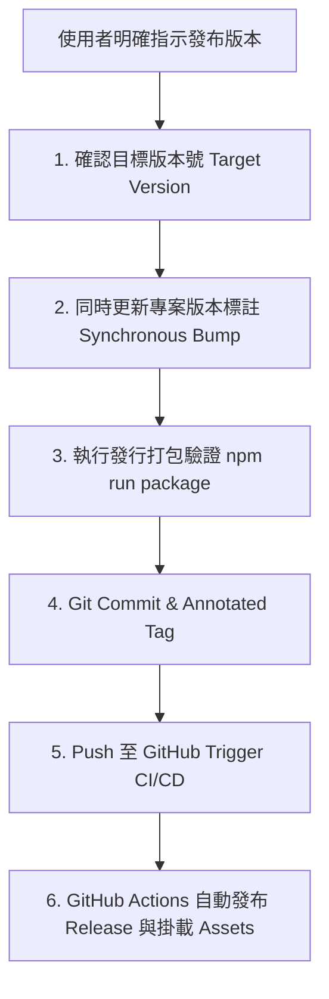

# AGY Git Graph - Release Skill 🚀

本技能專用於 **AGY Git Graph 的版本發布與 GitHub Release 流程**。

> ⚠️ **執行防線**：
> **本技能僅在使用者明確要求發布至 Git / GitHub（例如：「發布新版本」、「Release vX.Y.Z」）時才能啟動執行。**
> 平時本機修改、除錯、測試時絕對不可觸發此流程！

---

## 發布工作流程 (Release Workflow)



---

## 詳細執行步驟

### 步驟 1：確認目標版本號 (Semantic Versioning)
- 確認本次發布版本號（例如：`1.0.1`、`1.1.0`）。若使用者未指定，預設由目前 `package.json` 的版本進行 patch 遞增（如 `1.0.0` -> `1.0.1`）。

### 步驟 2：同步更新程式與設定檔版本 (Synchronous Bump)
必須同時且一致地更新下列檔案中的版本號：
1. **`package.json`**：更新 `"version": "X.Y.Z"`
2. **`plugin.json`**：更新 `"version": "X.Y.Z"`
3. **`README.md`**：若有版本徽章或更新紀錄，同步更新

### 步驟 3：執行打包程式驗證 (Build & Package)
在專案根目錄執行發布打包腳本進行本地產物驗證：
```bash
npm run package
```
驗證 `dist/` 生成以下帶有版本號的發行包：
- `dist/agy-git-graph-v<VERSION>.zip` (通用 ZIP 壓縮包)
- `dist/agy-git-graph-v<VERSION>.tar.gz` (Linux / macOS 壓縮包)
- `dist/SHA256SUMS.txt` (校驗碼清單)

> 注意：`dist/` 已被 `.gitignore` 忽略，嚴禁將 `dist/` 產物提交進 Git 倉庫。

### 步驟 4：Git 提交與建立標籤 (Commit & Tag)
嚴格以 `Corvus+` 身分進行提交與建立標籤：
```bash
git add package.json plugin.json README.md
git commit -m "chore(release): v<VERSION>"
git tag -a "v<VERSION>" -m "Release v<VERSION>"
```

### 步驟 5：推送至 GitHub 觸發自動發布 (Push to Trigger Release)
推送 Commit 與 Tag 至遠端 GitHub 儲存庫：
```bash
git push origin main --tags
```
專案內建的 GitHub Actions 工作流程（`.github/workflows/release.yml`）偵測到 `v*` 標籤後，將會自動在乾淨的雲端環境建置發行包，並建立 GitHub Release 掛載發行物！

### 步驟 6：回報使用者
發布完成後，向使用者回報：
- 本次發布版本號。
- GitHub Release 頁面連結：`https://github.com/Commit-Or-Die-Studio/agy-git-graph/releases/tag/v<VERSION>`。
